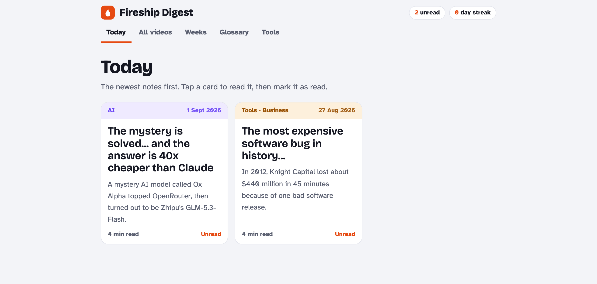
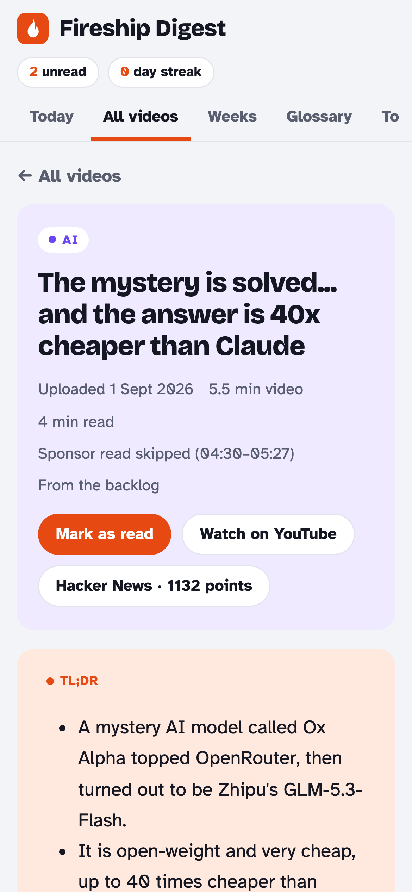
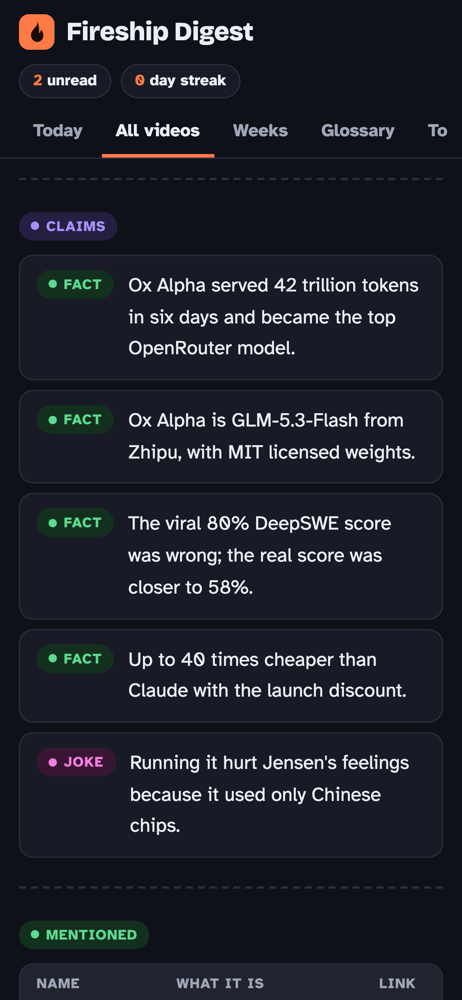
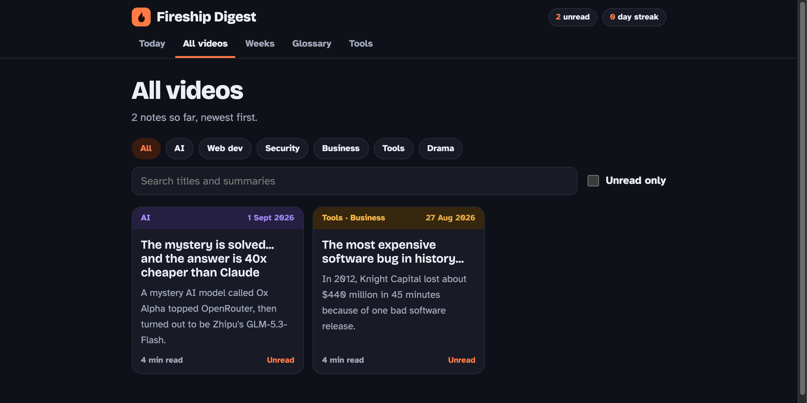

# Personal-Dev-Digest

I've never skipped a fireship video and I always find those videos useful so this is just a little something to
ease up things. 
A personal daily routine that turns dev and AI news into simple, lightly researched notes in a small private
web app, so I keep up without watching or reading everything.

**Sources.** [Fireship](https://www.youtube.com/@Fireship) is the main one: every new upload becomes a note.
On days without a new Fireship video, the free slots go to the day's top dev or AI story on
[Hacker News](https://news.ycombinator.com) (300+ points) and an older Fireship "... in 100 Seconds" classic
on any topic.



<p align="center">
  
  &nbsp;&nbsp;
  
</p>



## The app

A phone-friendly page with five tabs:

- **Today**: the two newest notes as big cards, then everything still unread.
- **All videos**: every note as a card, filtered by kind (videos, news, classics), by topic (AI, Web dev,
  Security, Business, Tools, Drama), by search, or by "unread only".
- **Weeks**: a short wrap-up every Sunday.
- **Glossary**: every term from every note, A to Z, in plain words.
- **Tools**: everything the notes mentioned, with official links.

Each note has its own page with colour-labelled sections: TL;DR, What was said, Key moments (links that jump
to that second of the video), Claims (fact, opinion or joke), Mentioned, Glossary, For me as a developer, and
What happened since (for older videos). "Mark as read" feeds the unread count and a reading streak, and an
"Ask Claude" box answers questions about the note in simple words.

The notes are written in simple English: short sentences, everyday words, every tech term explained right where
it appears, and one "think of it like..." comparison per note.

> Side note: each run also adds a reminder to Apple Reminders at 13:00 ("Read Fireship Digest: 2 new,
> 3 unread", with the titles and the app link). iCloud syncs it to my iPhone, and the app sits on my home screen.

## How it works

```
11:00  Claude Code scheduled task (local, on my Mac), following ROUTINE.md
  │
  ├─ python3 fireship.py prepare
  │     ├─ yt-dlp lists Fireship's Videos tab (Shorts are skipped); new uploads go first
  │     ├─ no new upload? the top dev/AI Hacker News story and a "100 Seconds" classic fill the slots
  │     ├─ yt-dlp downloads English captions and the description (never the video),
  │     │  or, for news, the HN API gives the story and its top-ranked comments
  │     ├─ SponsorBlock gives the sponsor segment, which is cut out and replaced by a marker
  │     └─ prints a JSON manifest with today's items and their clean transcripts
  │
  ├─ for each item the model reads the transcript, fixes misheard names, runs
  │     python3 fireship.py hn "<name>" ...   (free Hacker News lookup near the upload date)
  │  and does 1 to 3 web searches and at most 2 page reads
  │
  ├─ the model writes draft.json: plain fields only (TL;DR, paragraphs, claims, links, ...)
  ├─ python3 fireship.py check draft.json
  │     validates every field, the 450-word and 1,000-word limits and the links,
  │     then prepares one JSON file per database document
  ├─ ONE database write (a batch that points at those files, so nothing is retyped)
  ├─ python3 fireship.py done --from draft.json   (also copies the notes to a local backup folder)
  └─ python3 fireship.py remind --reads N
```

The model writes content; the script owns format, validation and bookkeeping. That keeps the daily run short,
stops formatting mistakes before they reach the app, and enforces the length limits in code.

| File | Purpose |
| --- | --- |
| `fireship.py` | Picking items, captions, sponsor removal, Hacker News, draft check, done marking, backup, reminder |
| `ROUTINE.md` | The instructions the scheduled run follows: steps, research budget, draft format, language rules |
| `page/index.html` | The web app (vanilla JS); it reads the notes from the app's own small database |
| `state.json`, `transcripts/`, `draft.json`, `outbox/` | Local working data, not in git |
| `../<this folder>-backup/` | A JSON copy of every saved note, next to the repo and outside git |

## Design decisions

- **Idempotent runs.** A second run on the same day re-offers only unfinished items and never picks extra ones.
  An item that fails (no captions yet) is retried on later runs, up to three times.
- **Self-repairing downloads.** When yt-dlp fails in a way that looks like a YouTube change, the script runs
  `brew upgrade yt-dlp` once and retries before it reports a problem.
- **Sponsor reads are removed before the model reads anything**, using SponsorBlock's crowd-sourced segments.
- **A hard research budget** (3 searches and 2 page reads per item) keeps the cost small and predictable.
- **Hacker News through code, not searches.** HN search needs every word of a query to match, so the helper
  takes short names, tries them in order, and keeps only threads whose title names the topic. News stories
  must match a dev/AI word list, which keeps out the off-topic front-page hits.
- **A local backup.** The notes live in the app's database on claude.ai; every run also copies them to a folder
  on the Mac, so they survive whatever happens to the app.

## Cost

Measured on the Claude Pro plan: one run (two notes, Sonnet) takes about 2 minutes and uses about 1 to 2% of
the 5-hour usage window, and less than 1 point of the weekly limit.

## Use it yourself

You need macOS with [Homebrew](https://brew.sh), Python 3, yt-dlp (`brew install yt-dlp`), and the Claude
desktop app on a paid plan that includes Claude Code. Everything runs on your own Claude account and usage;
nothing here is tied to mine.

1. Clone this repo, ideally outside a synced folder.
2. Open the folder in a Claude Code session in the desktop app and ask Claude to publish `page/index.html` as
   a private artifact with the `db` and `sample` capabilities. Then save its link:
   `python3 fireship.py set-page <artifact link>`
3. Optional: in `ROUTINE.md`, section 3, adjust the `for_me` rule (the "For me as a developer" section) to fit
   what you want from each note.
4. Run `python3 fireship.py prepare` once to see the first two items it would pick.
5. In the Claude app, Code tab, Routines: create a local routine in this folder that runs daily with the prompt
   "Read ROUTINE.md in this folder and follow it exactly", and set its model (Sonnet) and permission mode.
6. Click "Run now" once. macOS asks once to let Claude control Reminders. On a machine without Apple
   Reminders, delete step 5 of `ROUTINE.md`.

## Privacy

Only captions and descriptions are downloaded, never the video. Transcripts stay on the local machine and are
deleted once the note is saved. The app itself is private; the screenshots above show two real notes.

## Limitations

- The Mac must be awake with the Claude app open at 11:00. A missed run catches up once when it wakes.
- Auto-captions mishear names; the routine corrects them from the title, the description and its searches,
  but mistakes can slip through.

## Credits

[yt-dlp](https://github.com/yt-dlp/yt-dlp) for captions, [SponsorBlock](https://sponsor.ajay.app) for sponsor
segments, the [HN Search API](https://hn.algolia.com/api) and the
[official Hacker News API](https://github.com/HackerNews/API) for news and discussions.

## License

[MIT](LICENSE)
